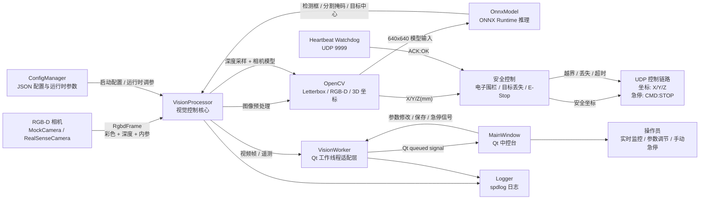
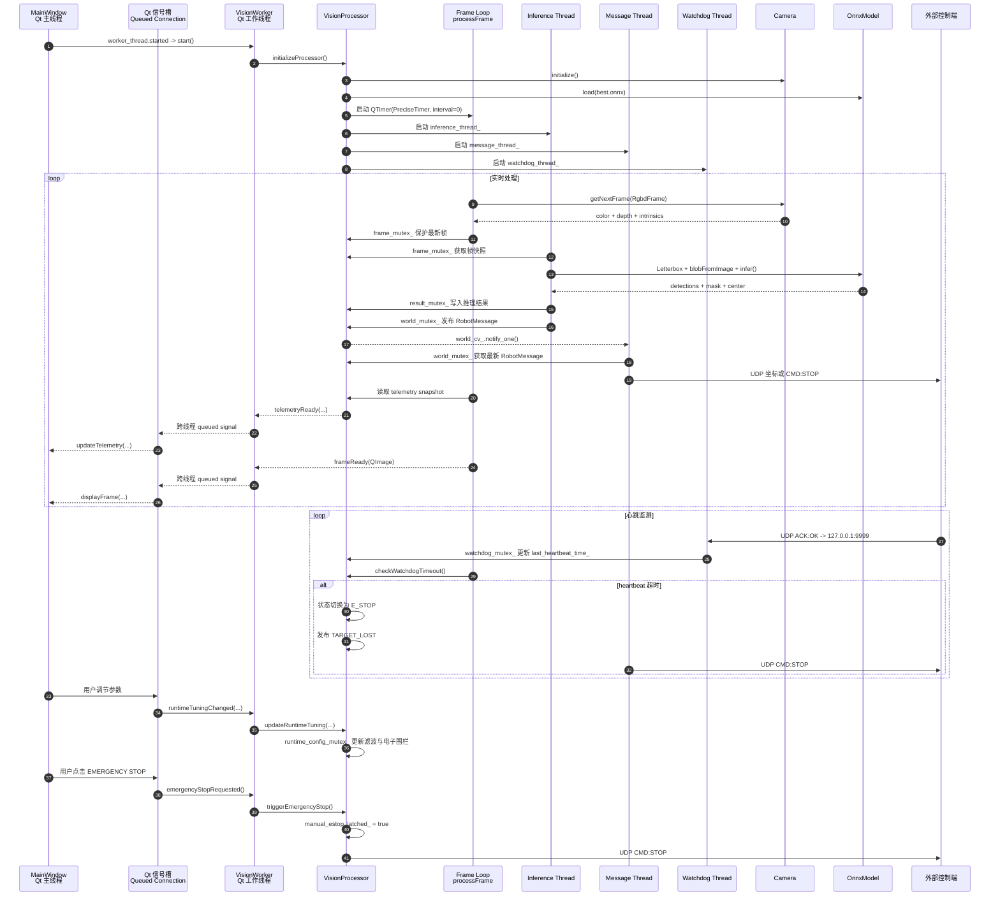
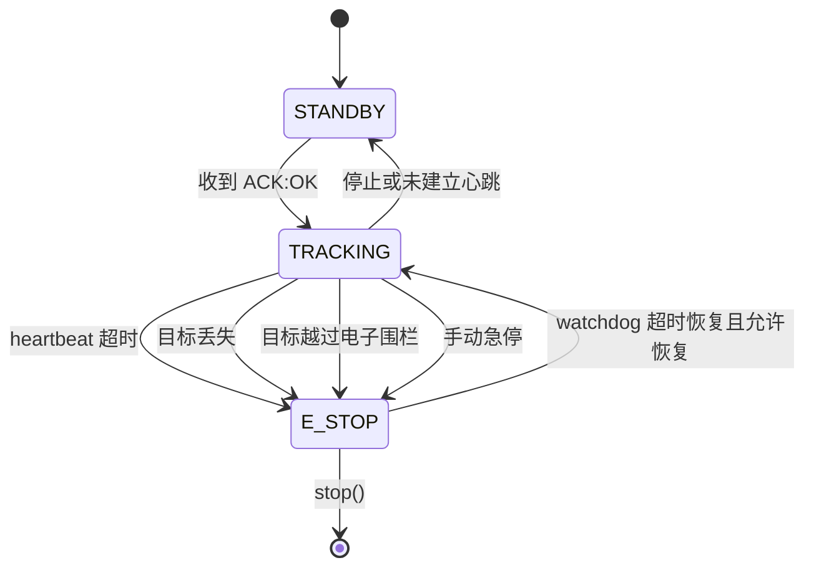

# Medical Vision Controller

基于 C++、Qt、OpenCV 与 ONNX Runtime 的实时视觉控制系统。系统从 RGB-D 相机获取图像，使用视觉模型检测目标并提取目标中心，通过深度信息和相机内参计算三维坐标，经过安全边界与心跳 watchdog 校验后，以 UDP 向外部控制端发送坐标或急停指令。

**Medical Vision Controller** is a real-time vision-based control system built with C++, Qt, OpenCV, and ONNX Runtime. It captures RGB-D frames, runs neural-network inference, estimates 3D target coordinates from depth and camera intrinsics, applies safety and heartbeat checks, and sends either `X/Y/Z` coordinates or an emergency-stop command over UDP.

## 快速开始 | Quick Start

> 当前推荐使用 Windows + MockCamera 完成首次运行。RealSense 是可选后端，需要额外的 SDK、硬件和编译验证。
>
> The recommended first run is Windows + MockCamera. RealSense is an optional backend and requires additional SDK setup, hardware, and validation.

### 1. 获取依赖 | Install Dependencies

| 依赖 | 要求 | Dependency | Requirement |
| --- | --- | --- | --- |
| 操作系统 | Windows 10/11，MSVC 64-bit | Operating system | Windows 10/11, MSVC 64-bit |
| C++ | C++17 | C++ | C++17 |
| 编译系统 | CMake 3.15 或更高版本 | Build system | CMake 3.15 or newer |
| Qt | Qt 6，包含 `Widgets`，推荐 MSVC 2022 64-bit 套件 | Qt | Qt 6 with `Widgets`, MSVC 2022 64-bit recommended |
| OpenCV | OpenCV 4.x，包含开发头文件、库和 Windows DLL | OpenCV | OpenCV 4.x with headers, libraries, and Windows DLLs |
| ONNX Runtime | Windows x64 C/C++ package | ONNX Runtime | Windows x64 C/C++ package |
| CMake FetchContent | `spdlog` v1.14.1、`nlohmann/json` v3.11.3 | CMake FetchContent | `spdlog` v1.14.1 and `nlohmann/json` v3.11.3 |

项目会通过 CMake `FetchContent` 自动获取 `spdlog` 和 `nlohmann/json`。OpenCV、Qt 和 ONNX Runtime 需要提前安装。

The project fetches `spdlog` and `nlohmann/json` through CMake `FetchContent`. Qt, OpenCV, and ONNX Runtime must be installed separately.

### 2. 配置依赖路径 | Configure Dependency Paths

PowerShell:

```powershell
cmake -S . -B build `
  -G "Visual Studio 17 2022" `
  -A x64 `
  -DOpenCV_DIR="C:\path\to\opencv\build" `
  -DONNXRUNTIME_DIR="C:\path\to\onnxruntime"
```

Qt 需要能够被 CMake 的 `find_package(Qt6 COMPONENTS Widgets)` 找到。若 Qt 不在系统默认搜索路径中，可以额外设置：

```powershell
$env:CMAKE_PREFIX_PATH = "C:\Qt\6.8.0\msvc2022_64"
```

Make sure CMake can resolve `find_package(Qt6 COMPONENTS Widgets)`. If Qt is not in a default search path, set:

```powershell
$env:CMAKE_PREFIX_PATH = "C:\Qt\6.8.0\msvc2022_64"
```

`ONNXRUNTIME_DIR` 应指向包含 `include` 和 `lib` 子目录的 ONNX Runtime 根目录，例如：

```text
C:\third_party\onnxruntime\
├─ include\
└─ lib\
   ├─ onnxruntime.lib
   └─ onnxruntime.dll
```

`ONNXRUNTIME_DIR` must point to an ONNX Runtime root containing `include` and `lib`:

```text
C:\third_party\onnxruntime\
├─ include\
└─ lib\
   ├─ onnxruntime.lib
   └─ onnxruntime.dll
```

### 3. 一键编译 | One-command Build

```powershell
cmake --build build --config Release --parallel
```

首次配置、编译和运行可以连续执行：

```powershell
cmake -S . -B build `
  -G "Visual Studio 17 2022" `
  -A x64 `
  -DOpenCV_DIR="C:\path\to\opencv\build" `
  -DONNXRUNTIME_DIR="C:\path\to\onnxruntime"
cmake --build build --config Release --parallel
```

For a complete first-time setup:

```powershell
cmake -S . -B build `
  -G "Visual Studio 17 2022" `
  -A x64 `
  -DOpenCV_DIR="C:\path\to\opencv\build" `
  -DONNXRUNTIME_DIR="C:\path\to\onnxruntime"
cmake --build build --config Release --parallel
```

### 4. 运行 GUI | Run the GUI

构建后，CMake 会自动复制 `config.json`、`models`、ONNX Runtime DLL 和 OpenCV DLL 到可执行文件目录。运行：

```powershell
.\build\Release\VisionApp.exe
```

After the build, CMake copies `config.json`, `models`, the ONNX Runtime DLL, and OpenCV DLLs next to the executable:

```powershell
.\build\Release\VisionApp.exe
```

> Visual Studio 多配置生成器的实际输出目录通常是 `build\Release` 或 `build\Debug`。如果使用 Qt Creator 的现有构建目录，请以该目录中的 `VisionApp.exe` 为准。
>
> With the Visual Studio multi-config generator, the executable is usually under `build\Release` or `build\Debug`. When using Qt Creator, run the `VisionApp.exe` from the configured build directory.

### 5. 运行无界面模式 | Run Headless

```powershell
.\build\Release\VisionApp.exe --headless
```

无界面模式仍会启动视觉处理、UDP 通信和 watchdog，但不会创建 Qt Widgets 窗口。

Headless mode still starts vision processing, UDP communication, and the watchdog, but does not create a Qt Widgets window.

### 6. 启动心跳发送器 | Start the Heartbeat Sender

系统默认监听 `127.0.0.1:9999` 的 `ACK:OK` 心跳。另开一个 PowerShell 窗口运行：

```powershell
python .\send_heartbeat.py
```

The system listens for `ACK:OK` heartbeats on `127.0.0.1:9999`. In another PowerShell window:

```powershell
python .\send_heartbeat.py
```

如果停止心跳超过 `heartbeat_timeout_ms`，系统会进入 `E_STOP` 并发送 `CMD:STOP`。

If the heartbeat is absent for longer than `heartbeat_timeout_ms`, the system enters `E_STOP` and sends `CMD:STOP`.

### 7. 配置 MockCamera | Configure MockCamera

首次演示建议使用合成 RGB-D 帧，这样不依赖物理摄像头。将 `config.json` 中的 `Camera` 配置调整为：

```json
{
  "Camera": {
    "backend": "mock",
    "source": "",
    "synthetic_fallback": true,
    "mock_depth_mm": 500.0
  }
}
```

For the first demo, use synthetic RGB-D frames so no physical camera is required. Set the `Camera` section in `config.json` to:

```json
{
  "Camera": {
    "backend": "mock",
    "source": "",
    "synthetic_fallback": true,
    "mock_depth_mm": 500.0
  }
}
```

## 可选：RealSense 后端 | Optional: RealSense Backend

RealSense support is optional and disabled by default. The backend is present in the source tree, but it requires `librealsense2` and a physical device for validation.

```powershell
cmake -S . -B build-realsense `
  -G "Visual Studio 17 2022" `
  -A x64 `
  -DOpenCV_DIR="C:\path\to\opencv\build" `
  -DONNXRUNTIME_DIR="C:\path\to\onnxruntime" `
  -DMEDICAL_VISION_ENABLE_REALSENSE=ON `
  -DREALSENSE_DIR="C:\path\to\librealsense"
cmake --build build-realsense --config Release --parallel
```

然后将配置改为：

```json
{
  "Camera": {
    "backend": "realsense"
  }
}
```

Do not describe this mode as production-ready until it has been tested with the target RealSense device, firmware, driver, and runtime environment.

## 系统架构



### 模块职责

| 模块 | 职责 |
| --- | --- |
| `MainWindow` | 展示视频、三轴坐标、系统状态、网络状态和安全状态；发出运行时调参、保存配置和手动急停请求 |
| `VisionWorker` | Qt 工作线程中的适配层，负责启动/停止视觉处理，并把核心数据转换为 Qt 可消费的图像和遥测信号 |
| `VisionProcessor` | 系统核心控制器，协调采集、推理、坐标计算、状态机、UDP 发送和 watchdog |
| `OnnxModel` | 管理 ONNX Runtime session，执行检测/分割推理、NMS、掩码重建和目标中心提取 |
| `ICameraBase` | 抽象 RGB-D 相机接口，允许 MockCamera 与可选 RealSenseCamera 替换 |
| `ConfigManager` | 读取和保存 `config.json`，集中管理网络、相机、控制和安全参数 |
| `Logger` | 统一输出运行日志、警告、调试信息和安全事件 |

## 数据流与控制闭环

系统的核心闭环可以概括为：

```text
RGB-D 帧
  -> Letterbox 与模型预处理
  -> ONNX Runtime 检测/分割
  -> 目标中心滤波
  -> 像素坐标反投影到三维坐标
  -> 电子围栏与 heartbeat watchdog 校验
  -> UDP 发送坐标或 CMD:STOP
  -> Qt 中控台显示当前状态
```

其中：

- 目标中心使用指数滤波降低视觉抖动；
- 深度值在目标像素附近的 `5 x 5` 邻域内取有效深度中值；
- 目标越界、目标丢失或 heartbeat 超时都会进入 `E_STOP`；
- 进入急停状态后，控制链路发送 `CMD:STOP`，而不是继续发送坐标；
- UI 的实时参数可以修改滤波系数和电子围栏尺寸，并通过 `ConfigManager` 保存。

## 多线程时序

下面的时序图展示 UI 主线程、`VisionWorker` Qt 工作线程以及 `VisionProcessor` 内部线程之间的数据流转。



### 通信模型说明

当前实现采用“Qt queued signal + 核心模块互斥锁”的线程安全模型：

- `MainWindow` 不直接操作视觉处理对象，只通过 Qt 信号槽向 `VisionWorker` 发送命令；
- `VisionWorker` 将 `VisionProcessor` 放在独立 Qt 工作线程中，避免阻塞 UI；
- `VisionProcessor` 内部使用采集帧、推理结果、机器人消息和 watchdog 状态等不同 mutex 分离保护；
- `world_cv_` 用于唤醒消息线程，避免消息线程持续空转；
- UI 收到 `frameReady` 与 `telemetryReady` 后，只负责更新界面；
- UI 与视觉处理之间不存在直接共享 QWidget 或 OpenCV 缓冲区的操作。

> 注意：当前代码并不是严格意义上的 lock-free queue 实现。更准确的描述是“基于 Qt 异步信号槽、条件变量和细粒度互斥锁的线程安全通信”。如果未来要实现无锁 SPSC/MPSC 队列，需要额外引入明确的队列数据结构、容量策略、内存序和丢帧策略。

## 状态机与安全策略



## 当前实现边界

- 默认相机后端为 `MockCamera`；
- RealSense 后端位于可选编译开关之后，需要 librealsense2 和真实设备验证；
- 控制链路当前为 Windows UDP 实现；
- 模型输入固定为 `640 x 640`，推理输出按当前 YOLO-seg 输出结构解析；
- README 中的时序图按当前源码实现描述，不将尚未实现的无锁队列表述为既成事实。
